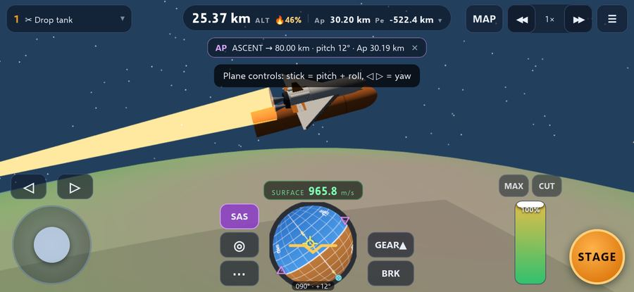
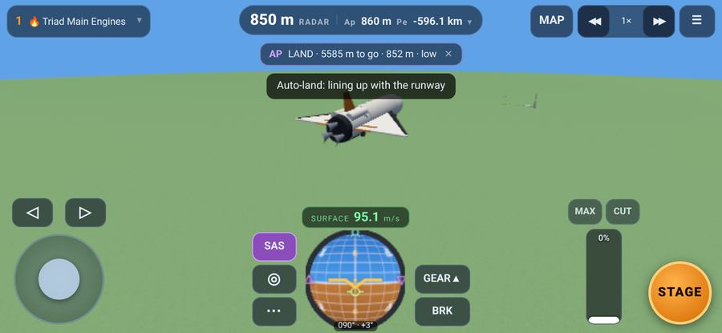
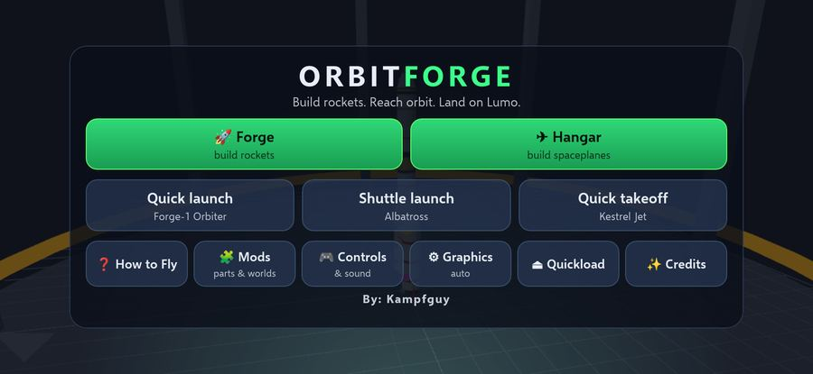
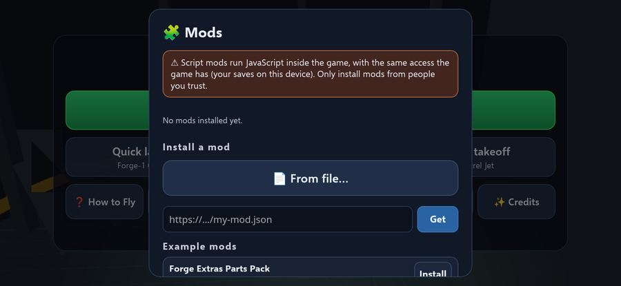

# Orbit Forge

**By: Kampfguy**

Orbit Forge is an original 3D rocket and spaceplane game that runs in the browser. You build a rocket or a spaceplane, fly it to orbit around the home planet **Kampa**, and go on to the moons **Lumo** and **Pip**. It's tuned for Safari on iPhone, and it also runs on Mac Safari, Chrome and Firefox.

▶ **Play:** https://kampfguy.github.io/OrbitForge/

 

 

## Features
- **3D builder ("the Forge").** Pods, 1.25 m and 2.5 m tanks, four liquid engines, two solid boosters, stack and side splitters, nose cones, fins, an adapter and a parachute.
  - Parts stack and snap together. Side boosters attach radially with symmetry (×1/2/3/4/6).
  - Delete and undo.
  - Stages are worked out automatically, with live Δv, TWR and burn time for each stage.
  - Crafts save to the device, and there are 4 stock example crafts.
- **The Hangar (spaceplanes).** A second editor where planes are built lying flat.
  - Parts: Hawk and Heron cockpits, fuselage tanks, a tail cone, delta and straight wings, strakes, elevons, a rudder tail, tail fins, nose and main landing gear, a shock-cone intake and side intakes.
  - Engines: the Gust Turbojet (air-breathing only) and the Twinmode Hybrid (breathes air up to about Mach 5 and 25 km, then switches to rocket mode on its own).
  - Wings, gear and intakes are always mirrored. Live CoM (yellow), CoL (blue) and CoT (magenta) markers, plus design warnings.
  - Stock planes: **Kestrel Jet** and **Skylance SSTO**.
- **Runway and hangar** at the space center. The runway runs east-west and is 2.4 km long.
- **Flight model for planes.**
  - Each wing surface has its own lift and drag with angle of attack, stall and Mach effects.
  - Control surfaces deflect automatically for pitch, roll and yaw, from the pilot or from SAS.
  - Spring-damper wheels with rolling resistance, brakes (`B`), side friction and nose-wheel steering.
  - Retractable gear (`G`). Jets spool up, and need intakes and air.
- **Loading screen** with original artwork rendered from the game itself, a progress bar and rotating tips.
- **3D flight.** Kampa has a 600 km radius and 9.81 m/s² surface gravity.
  - The atmosphere reaches 70 km, with exponential density, drag and pressure-dependent engine Isp.
  - Physics runs on a fixed 50 Hz timestep.
  - Throttle, staging, debris, parachutes, landings, crashes and recovery.
- **SAS** with stability hold plus prograde, retrograde, normal, anti-normal, radial in/out and maneuver modes. The navball is 3D, with surface and orbit speed modes.
- **Orbits.** Patched conics with SOI transitions to Lumo and Pip, using a universal-variable Kepler propagator. Time warp has physics warp (1-4×) and on-rails warp (up to 100 000×).
- **Map view** in 3D with trajectory patches, Ap/Pe/encounter labels and maneuver nodes.
  - Nodes have prograde, normal and radial Δv, with time adjust and snap to Ap/Pe.
  - You can also tap the orbit line to place a node.
  - Shows a burn timer and the predicted encounter periapsis.
- **Floating origin.** Everything renders relative to the vessel, and physics runs in JS doubles, so there's no jitter far from Kampa.
- **Mobile controls, tuned for the iPhone 12.**
  - Compact navball at the bottom center with the speed readout.
  - SAS button plus a SAS-mode pop-up.
  - Collapsible staging chip, and an altitude pill that expands on tap.
  - Joystick and roll under the left thumb. Throttle and a big STAGE button under the right.
  - GEAR and BRK buttons for planes.
  - In map view, the node editor moves to the left side (landscape) or a bottom sheet (portrait).
  - The builders use a slide-out parts drawer.
  - Landscape is recommended. A dismissible hint appears in portrait.
- **PWA.** You can Add to Home Screen.

- **Steering that behaves.** A damped rate controller: the craft stops turning when you let go (instead of drifting), SAS holds where you released, inputs are eased, and there's a precision mode (◎ / Caps Lock).
  - Planes fly like planes: the stick commands bank and pitch, and they hold a turn or a climb when you let go.
  - ⚙ **Controls & sound** (main menu or flight ⋯): sensitivity, separate rocket/plane feel, optional tilt steering on phones, sound volume.
- **Autopilot** (SAS pop-up): ascent to a target orbit (staging included), heading + altitude hold for planes, reentry guidance and an automatic runway landing.
- **Shuttles.** Orbiter wings and body with cargo bay doors (`O`), an external tank, side boosters, gimballing main engines aimed through the centre of mass, and heat tiles. Stock **Albatross Shuttle**: launch from the pad, fly to orbit, glide back to the runway. Any craft can launch from the pad or the runway (editor ⋯ → Launch site).
- **Reentry heating**, with heat shields and tiles, a heat gauge and parts that break off when they overheat.
- **RCS** with rotation help and translation (`R`, `H/N J/L I/K`, or ✥ Move on the joystick), **landing legs** (`G`). The brakes button doubles as an airbrake in flight, and the landing autopilot pops a drag chute on a glider rollout.
- **Quicksave / quickload** (`F5` / `F9`, flight ⋯ menu, or main menu).
- **Sounds** made live with WebAudio (engines, wind, staging, clicks). No audio files.
- **Mods.** Add parts, moons, crafts, tips and scripts from JSON files (🧩 Mods on the main menu). Four example mods are in [`mods/`](mods/). See **[MODDING.md](MODDING.md)**. Script mods run code, so only install ones you trust.

## Controls (keyboard)
`W/S` pitch (W = nose down) · `A/D` yaw · `Q/E` roll · `Shift/Ctrl` throttle · `Z` full · `X` cut · `Space` stage · `T` SAS · `M` map · `G` gear · `B` brakes (hold) · `,` `.` warp · `R` RCS · `H/N J/L I/K` RCS translate · `O` bay doors · `Caps Lock` precision · `F5/F9` quicksave/load · `Esc` menu

**Planes:** on the runway, press STAGE to start the engine, go to full throttle, and pull back (`S` or stick down) at about 70-90 m/s. The stick banks the plane in the air and steers the nose wheel on the ground.

## Tech
Plain ES modules with no build step. three.js r170 is vendored in `js/vendor/` (MIT).

| File | What's in it |
|------|--------------|
| `js/orbit.js` | bodies, Kepler propagation, patched-conic prediction |
| `js/craft.js` | craft layout, staging, Δv |
| `js/parts.js` | part definitions and procedural meshes |
| `js/world.js` | planets, terrain patch, sky |
| `js/flight.js` | simulation, HUD, map, nodes |
| `js/builder.js` | the Forge (rockets) and the Hangar (planes) |
| `js/navball.js` | the navball |
| `js/control.js` | pilot input: settings, stick shaping, key easing, tilt steering (the controller itself is in `flight.js`) |
| `js/autopilot.js` | ascent, hold, reentry and landing autopilot |
| `js/audio.js` | WebAudio sound |
| `js/mods.js` | mod loader, mod API, Mods menu |
| `js/main.js` | app shell |

Tests in `tests/` drive the game headlessly with Playwright (Chromium and WebKit). They include `plane.py` (runway takeoff and climb), `ssto.py` (spaceplane to orbit), `interaction.py` (building a rocket and a plane with taps, then flying them with the on-screen controls) `render_art.py` (renders the loading-screen art), `steer_bench.py` (steering benchmark), `shuttle.py`, `reentry.py`, `landing.py` and `r3_features.py` (mods, quicksave, RCS, legs, bay).

All names, parts, models and code are original. Gameplay is inspired by the rocket-sim genre.
